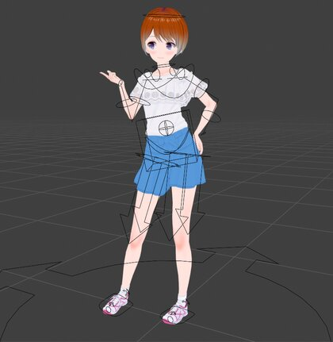
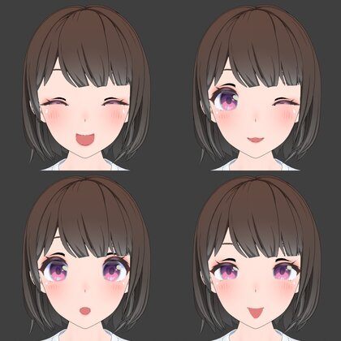
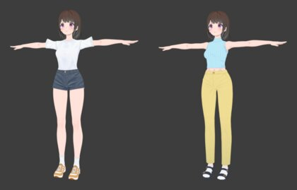
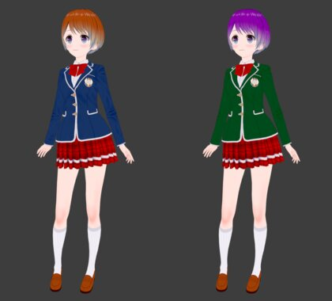
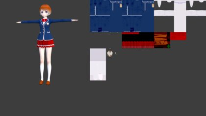
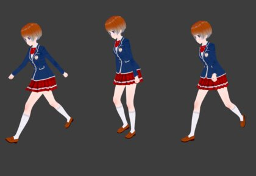
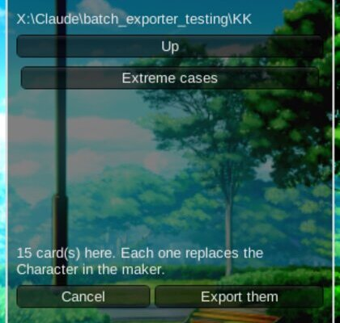

# KKBP

KKBP brings a character from Koikatsu, Koikatsu Sunshine or Summer Vacation Scramble into Blender, shaded, rigged and ready to pose.

It has two parts. An **exporter** runs inside the game and saves the character data to a folder. An **importer** runs inside Blender and rebuilds the character from that folder.

**[Download the latest release](../../releases/latest)** · [Install](#install) · [Usage](#usage) · [Documentation](docs/wiki/README.md)

## Features

<table>
<tr>
<td width="25%" valign="top"> <b><a href="docs/wiki/shaders.md">Looks like the game</a></b> Shaders for Eevee and Cycles, a plain Principled setup, and the game's outlines.</td>
<td width="25%" valign="top"> <b><a href="docs/wiki/rig.md">A fully featured Rigify rig</a></b> A Rigify control rig, with elbows, knees and shoulders corrected by the game's own rules.</td>
<td width="25%" valign="top"> <b><a href="docs/wiki/expressions.md">Every expression</a></b> All the game's eye and mouth expressions with English names, face controls with emotion presets, gag eyes and tears.</td>
<td width="25%" valign="top"> <b><a href="docs/wiki/outfits.md">Every outfit</a></b> All of a card's outfits in one import, with their half-off variations if you want them.</td>
</tr>
<tr>
<td valign="top"> <b><a href="docs/wiki/edit-material.md">Recolour anything</a></b> Edit Material rebuilds a material from the game's layers and colours, then bakes your changes.</td>
<td valign="top"> <b><a href="docs/wiki/export-prep.md">Export to other programs</a></b> Export Prep readies the character for VRM, VRChat or Unreal, with a texture atlas.</td>
<td valign="top"> <b><a href="docs/wiki/animation.md">Import Koikatsu animations</a></b> Put a Koikatsu <code>.fbx</code> animation on the rig, with no other add-on.</td>
<td valign="top"> <b><a href="docs/wiki/importing.md">Batch Exporting</a></b> Export a folder of cards, import a folder of exports, and run <a href="docs/wiki/hooks.md">your own scripts</a> after each import.</td>
</tr>
</table>

The Blender panel is in English, 简体中文, Français, Deutsch, Bahasa Indonesia, 日本語, Português, Русский, Español and ไทย.

## Supported games

| Game | What the game needs | The exporter window opens with |
|---|---|---|
| Koikatsu | BepInEx (HF Patch installs it) | the "Show KKBP Exporter" toggle in the maker's sidebar |
| Koikatsu Sunshine | BepInEx (HF Patch installs it) | the "Show KKBP Exporter" toggle in the maker's sidebar |
| Summer Vacation Scramble | BepInEx (HF Patch installs it) | Ctrl+Tab in the maker |

Blender 5.2 or newer. The differences between the games are listed in [Game support](docs/wiki/game-support.md).

## Install

Download two files from the [latest release](../../releases/latest): `kkbp-exporters-<version>.zip` and `kkbp-<version>.zip`.

**Install the exporter:**

1. Open `kkbp-exporters-<version>.zip`. It has one folder per game.
2. Open your game's folder in the zip and copy the `BepInEx` folder inside it.
3. Paste it into the game's main folder, the one with the game's `.exe`. It merges with the `BepInEx` folder already there.

| Game | Folder in the zip | The game's main folder has |
|---|---|---|
| Koikatsu | `Koikatsu` | `Koikatu.exe` |
| Koikatsu Sunshine | `Koikatsu Sunshine` | `KoikatsuSunshine.exe` |
| Summer Vacation Scramble | `Summer Vacation Scramble` | `SamabakeScramble.exe` |

**Install the importer:**

1. Open Blender
1. Open Edit > Preferences > Add-ons, open the menu at the top right and choose Install from Disk.
2. Pick `kkbp-<version>.zip`. Don't unzip it.
3. Press N in the 3D viewport and open the KKBP tab.
4. Click Download Pillow. This is needed once, and needs an internet connection.

[Installing](docs/wiki/installing.md) has the same steps with pictures, and how to update.

## Usage

**Export from the game:**

1. Open the character maker and load the character.
2. Open the exporter window: tick "Show KKBP Exporter" in the sidebar (Koikatsu, Koikatsu Sunshine) or press Ctrl+Tab (Summer Vacation Scramble).
4. Click Export Model for KKBP. The game freezes while it works.
5. The export is a new folder in `KKBP Exports`, in the game's main folder.

**Import into Blender:**

1. In the KKBP tab, click Import Export Bundle.
2. Browse to the export's folder, select `manifest.json` and click Import manifest.json.

The options of both plugins are explained in [Exporting](docs/wiki/exporting.md) and [Importing](docs/wiki/importing.md).

## Documentation

The [wiki](docs/wiki/README.md) explains each feature with pictures.

| Page | What it covers |
|---|---|
| [Installing](docs/wiki/installing.md) | Installing, updating and removing both plugins |
| [Exporting](docs/wiki/exporting.md) | The exporter window's options, and exporting a folder of cards |
| [Importing](docs/wiki/importing.md) | Every Import Option, saved defaults, Bulk Import, languages |
| [Shaders and outlines](docs/wiki/shaders.md) | The five shader choices and the outlines |
| [The rig](docs/wiki/rig.md) | The Rigify rig, Rig Layers, joint corrections, Snap IKs |
| [Expressions](docs/wiki/expressions.md) | The face rig and presets, gag eyes, tears, face cards |
| [Outfits](docs/wiki/outfits.md) | Outfits, variations, separate clothing, SFW mode |
| [Edit Material](docs/wiki/edit-material.md) | Changing colours and baking them |
| [Export Prep](docs/wiki/export-prep.md) | VRM, VRChat, Unreal, atlases |
| [Animations](docs/wiki/animation.md) | Importing a Koikatsu animation |
| [Hooks](docs/wiki/hooks.md) | Running your own scripts after an import |
| [Game support](docs/wiki/game-support.md) | What works in which game |
| [Troubleshooting](docs/wiki/troubleshooting.md) | The log, common problems, reporting a bug |

## Getting help

When an import goes wrong, the KKBP panel shows a summary with a button that opens the log. Check [Troubleshooting](docs/wiki/troubleshooting.md) first; if that doesn't help, open an issue and attach the log.

## Developers

- [CONTRIBUTING.md](CONTRIBUTING.md): the repository's layout and how to build and test it
- [docs/design/](docs/design/README.md): the design, and the decisions behind it in [docs/adr/](docs/adr/)
- [docs/hook-interface.md](docs/hook-interface.md): the API for writing a custom post-import script (a Hook)

## Similar Projects

