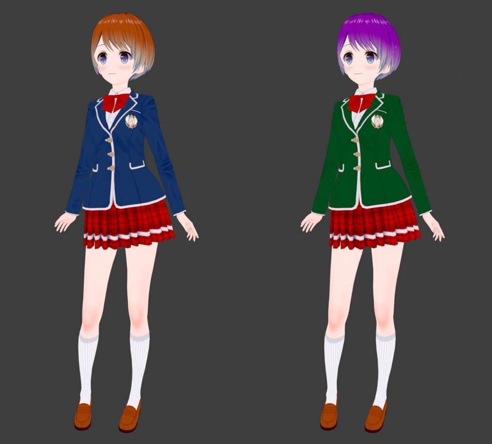
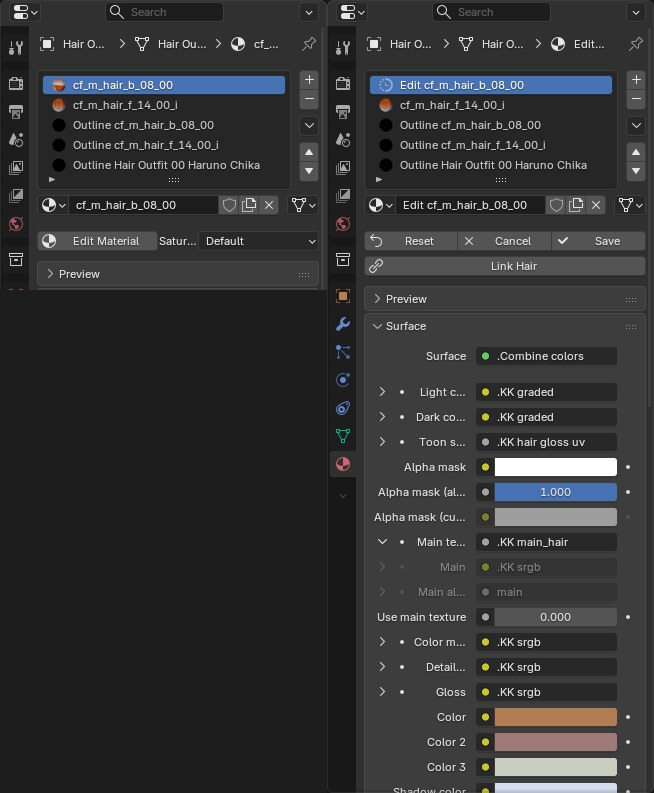

# Edit Material

Edit Material lets you change a material's colours, then bakes the result back into fast textures.

An imported material is a pair of finished textures, light and dark, which is fast but fixed. Edit Material swaps it for a version built from the game's original layers and colours, following the game's own shaders, so the colours can be changed and still look like the game.

Edit Material works in all three games. It needs the character's export folder to still be where it was imported from.

## Changing a colour

1. In Object Mode, select the object and open the Material tab of the Properties editor.
2. Select the material in the list and click Edit Material under it.
3. Change the colours under Surface. They sit a few levels down:
   - Hair: expand **Main texture**. The colours are Color, Color 2 and Color 3.
   - Clothes: expand **Light colors**, then **Color**, then **Main**. The colours are Color, Color 2 and Color 3, each with a pattern colour.
4. Click Save. The colours are baked into the material's light and dark textures.

| Button | What it does |
|---|---|
| Edit Material | Swaps the material for the editable one |
| Save | Bakes the edited colours into the original material and ends the edit |
| Cancel | Puts the original material back and drops the changes |
| Reset | Starts the edit again from the export |
| Link Hair | Shown on hair: puts every hair material of the object into edit with this one's settings |

## Hair

Hair is usually several materials. Edit one, click Link Hair to copy its light and dark settings to the others, then save.

## What can be edited

| Game | What can be edited |
|---|---|
| Koikatsu, Koikatsu Sunshine | The body, face, hair, eyes, eye whites, eyebrows, eyelines, nose line, teeth, tongue and clothes. For the eyes, the highlight colours and the pupil and highlight positions can be changed too |
| Summer Vacation Scramble | The body, face, hair, eyes, eye whites, eyebrows, eyelashes, nails, teeth, tongue, clothes, socks and accessories |

Tears, gag eyes, face cards and glasses can't be edited in any game, nor Summer Vacation Scramble's eyelids. A material from a modded shader may not be editable.

In Summer Vacation Scramble, saving the face also bakes its version without eyeshadow.

## Shown colours and Saturate

Beside the Edit Material button is a menu with Default, On and Off. What it does depends on the material, and its name says which.

**Shown colours** (Koikatsu and Koikatsu Sunshine, every material except those from modded shaders). The game darkens and saturates a material after its shader, so the colours it stores are paler than the result. With Shown colours on, which is the default, a colour field shows the colour as it appears on a lit, white part of the material. Type in or pick with the eyedropper the colour you want to see, from a reference image or from the scene. Use the Standard view transform, which the import sets. A part whose texture is darker than white, as clothes with folds drawn in are, still comes out darker than the colour. Set it to Off to see and edit the game's own values instead; an unedited material saves the same either way.

**Saturate** (materials from modded shaders). It decides whether the colours go through the game's colour grade. Default doesn't saturate. Try On for a material that comes out too pale.

Summer Vacation Scramble's materials show no menu: the game doesn't grade them after their shader, so there is nothing to switch.

## Where the files go

The baked textures are saved in the export folder's `kkbp_cache/` and packed into the `.blend`.

## Per game

| | Koikatsu | Koikatsu Sunshine | Summer Vacation Scramble |
|---|---|---|---|
| Edit Material | Yes | Yes. Clothes, teeth, tongue and skin are close but approximated | Yes, except the eyelids |
