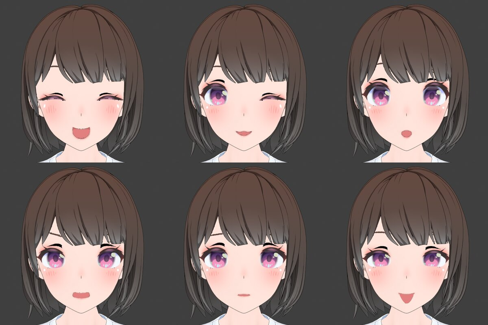
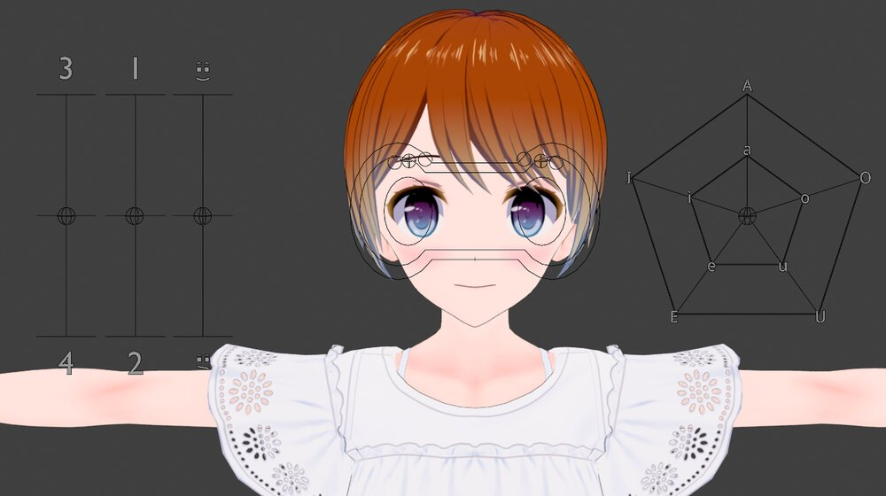

# Expressions

Every eye and mouth expression of the game comes into Blender as a shape key with an English name, and the rig has a grid of controls for them.

## Shape keys

The body's shape keys are named by what they do, with their category first: `Eye Closed`, `Eye Happy`, `Mouth Big A`. They are the game's complete expressions, so one key at full gives the expression as the game shows it. The names are the same in all three games.

## The emotion grid

With the [Rigify rig](rig.md), the face has controls for the mouth, the eyes and custom keys. Show them with the Emotions row of Rig Layers, then drag a control to blend between expressions.

## Gag eyes

The game's gag eyes (spirals, hearts, fiery eyes and so on) are one shape key, `Gag eyes`, and a dropdown:

1. Select the gag eyes object and open the Material tab, with its first material selected.
2. Under Surface, expand **Expression** and pick the expression in the `Gag expression` dropdown.
3. Raise the `Gag eyes` shape key on the body.

To change the gag expression during an animation, keyframe the `Number` value beside the dropdown.

The gag eyes and the tears are hidden until an expression shows them, and the normal eyes hide while the gag eyes show.

## Face cards

Face cards (off by default) adds flat 2D eye and mouth cards in front of the face, with the character's eye textures. Potentially useful for a more 2D look, a side face, or for goofy expressions. They are in a collection that starts switched off: tick its checkbox in the Outliner to use them.

From left to right: the face cards, the character's normal eyes with the face cards hidden, and the face with both hidden.

The cards sit in front of the character's own eyes and cover them. Where the eyes would still show around the cards, as when the head is turned, hide them too: separate them with [Separate eyes](#separate-eyes), hide the `Eyes` object, then set the `Eyeshadow` slider in the face material to a value of zero to hide the eyeshadow. Hiding both leaves the face without eyes, for drawing them another way.

## Separate eyes

Separate eyes (off by default) moves the eyes and eyebrows out of the body into their own objects, in an `Eyes and Eyebrows` collection. Their shape keys follow the body's. Use it to draw the eyes and eyebrows over the hair with the compositor. It also turns on the Cryptomatte Object and Material passes in the View Layer properties, which the compositor needs for that.

To do this on a character already imported, use Run Hook in the Tools panel and pick Separate Eyes.

## Per game

| | Koikatsu | Koikatsu Sunshine | Summer Vacation Scramble |
|---|---|---|---|
| Expression shape keys, emotion grid | Yes | Yes | Yes |
| Tongue during mouth expressions | Moves with the mouth | Moves with the mouth | Stays still in most, as in the game |
