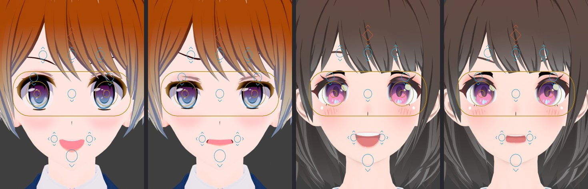
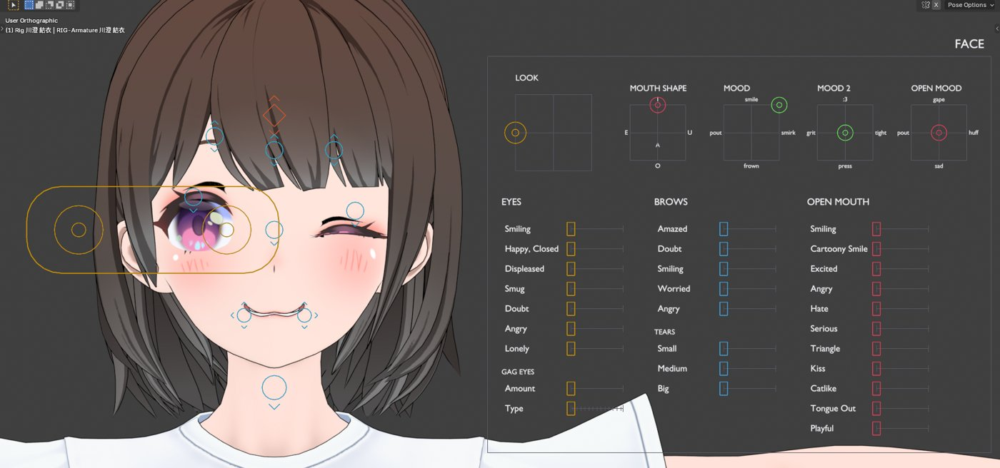
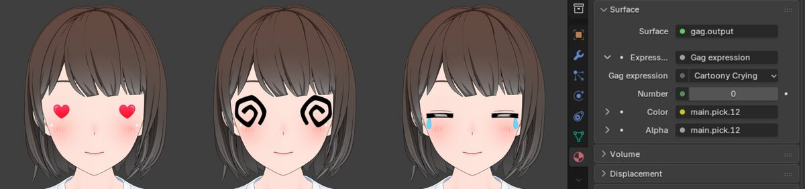
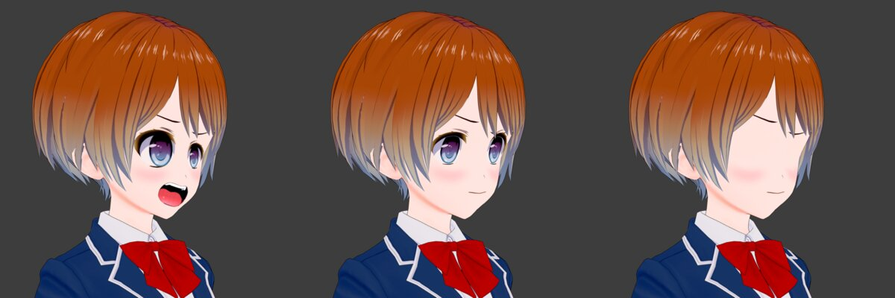

# Expressions

Every eye and mouth expression of the game comes into Blender as a shape key with an English name, and the rig has face controls and emotion presets for them.

## Shape keys

The body's shape keys are named by what they do, with their category first: `Eye Closed`, `Eye Happy`, `Mouth Big A`. They are the game's complete expressions, so one key at full gives the expression as the game shows it. The names are the same in all three games.

## The face rig

With the [Rigify rig](rig.md), the face has controls where they act, and a board beside the head for the rest. They show with the Face, Eyes and Emotions rows of Rig Layers.

On the face:

- **Blink**, between the eyes, closes both eyes as it moves down. The small control above each eye winks it.
- **The brows**: the middle control raises and lowers both brows, and the one on each brow raises or lowers only that brow.
- **Emote**, the orange diamond on the forehead: up is sad, down is angry.
- **Each mouth corner** moves up (smile), down (frown) or out (wide).
- **The jaw**, under the chin, opens the mouth.

On the board:

- **Look** moves the eyes. The eyes also follow the yellow target in front of the face. Scale the target to make the irises bigger or smaller.
- **Mouth shape** picks the shape the jaw opens: A in the middle, I, O, E and U at the edges.
- **Open mood** is four more open shapes, which take over from the mouth shape when you push it. Only one open shape is ever on, so the teeth and tongue never move twice.
- **Mood** and **Mood 2** shape the lips and work with any open shape.
- **The sliders** are for the other eye, brow and open-mouth expressions, the gag eyes (how much, and which gag) and the tears.

### Presets

The Face panel in the sidebar's KKBP tab has twelve emotion presets, such as Happy, Laugh, Sad and Angry. A preset moves the controls, so you can adjust the face with them afterwards. Shift-click a preset to add it to the face as it is, and set how strong presets are with Strength. Reset Face puts every control back; Key Face keys them all at the current frame.

The panel's Eyes section sets whether the eye target follows the head and how much the lids close when the eyes look down. More Expressions has a slider for every expression no control reaches.

Each game names its expressions differently, so the controls drive the keys that look right in each game: the same control may drive a differently named key in Koikatsu and in Summer Vacation Scramble.

## Gag eyes

The game's gag eyes (spirals, hearts, fiery eyes and so on) are one shape key, `Gag eyes`, and a dropdown:

1. Select the gag eyes object and open the Material tab, with its first material selected.
2. Under Surface, expand **Expression** and pick the expression in the `Gag expression` dropdown.
3. Raise the `Gag eyes` shape key on the body.

To change the gag expression during an animation, keyframe the `Number` value beside the dropdown.

The gag eyes and the tears are hidden until an expression shows them, and the normal eyes hide while the gag eyes show.

## Face cards

Face cards (off by default) adds flat 2D eye and mouth cards in front of the face, with the character's eye textures. Potentially useful for a more 2D look, a side face, or for goofy expressions. They are in a collection that starts switched off: tick its checkbox in the Outliner to use them.

From left to right: the face cards, the character's normal eyes with the face cards hidden, and the face with both hidden.

The cards sit in front of the character's own eyes and cover them. Where the eyes would still show around the cards, as when the head is turned, hide them too: separate them with [Separate eyes](#separate-eyes), hide the `Eyes` object, then set the `Eyeshadow` slider in the face material to a value of zero to hide the eyeshadow. Hiding both leaves the face without eyes, for drawing them another way.

## Separate eyes

Separate eyes (off by default) moves the eyes and eyebrows out of the body into their own objects, in an `Eyes and Eyebrows` collection. Their shape keys follow the body's. Use it to draw the eyes and eyebrows over the hair with the compositor. It also turns on the Cryptomatte Object and Material passes in the View Layer properties, which the compositor needs for that.

To do this on a character already imported, use Run Hook in the Tools panel and pick Separate Eyes.

## Per game

| | Koikatsu | Koikatsu Sunshine | Summer Vacation Scramble |
|---|---|---|---|
| Expression shape keys, face rig and presets | Yes | Yes | Yes |
| Tongue during mouth expressions | Moves with the mouth | Moves with the mouth | Stays still in most, as in the game |
