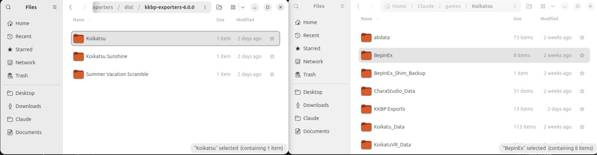
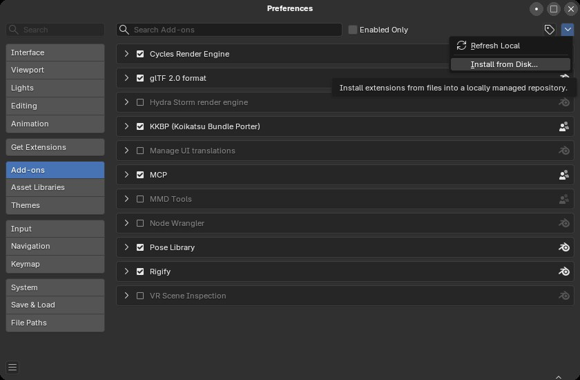
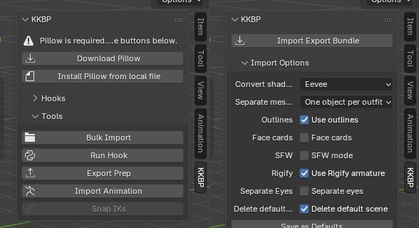

# Installing

KKBP is two downloads from the release page: the exporter for the game (`kkbp-exporters-<version>.zip`) and the importer for Blender (`kkbp-<version>.zip`).

## What you need

- Koikatsu, Koikatsu Sunshine or Summer Vacation Scramble, with BepInEx. HF Patch installs BepInEx.
- Blender 5.2 or newer.
- An internet connection the first time, for Blender to download Pillow.

## The exporter

1. Close the game.
2. Open `kkbp-exporters-<version>.zip`. It has one folder per game.
3. Open your game's folder in the zip and copy the `BepInEx` folder inside it.
4. Paste it into the game's main folder, the one with the game's `.exe`. Accept the prompt to merge folders.

| Game | Folder in the zip | The game's main folder has |
|---|---|---|
| Koikatsu | `Koikatsu` | `Koikatu.exe` |
| Koikatsu Sunshine | `Koikatsu Sunshine` | `KoikatsuSunshine.exe` |
| Summer Vacation Scramble | `Summer Vacation Scramble` | `SamabakeScramble.exe` |

The exporter is now in `BepInEx/plugins/KKBP/` in the game's folder.

## The importer

1. In Blender, open Edit > Preferences > Add-ons.
2. Open the menu at the top right and choose Install from Disk.
3. Pick `kkbp-<version>.zip`. Don't unzip it.
4. Close Preferences, press N in the 3D viewport and open the KKBP tab.
5. The panel says "Pillow is required". Click Download Pillow and wait a moment. The Import Export Bundle button then appears.

Pillow is an image library KKBP uses for its texture atlases. On a computer with no internet connection, download the Pillow wheel (`.whl`) for your Blender's Python and system on another computer, and click Install Pillow from local file, under Download Pillow.

## Updating

- **Exporter:** close the game and repeat the exporter steps, replacing the old file.
- **Importer:** install the new zip with Install from Disk, then restart Blender. If the panel asks for Pillow again, click Download Pillow again.

An export made by an older exporter still imports as long as the importer supports its format; the importer says so when it doesn't.

## Removing

- **Exporter:** delete `BepInEx/plugins/KKBP/` from the game's folder.
- **Importer:** in Preferences > Add-ons, open KKBP's menu and choose Uninstall.
