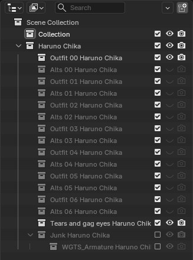

# Outfits

A card's outfits all come into Blender in one import, each in its own collection.

## Changing outfits

Tick Export All Outfits when [exporting](exporting.md#options). In Blender's Outliner each outfit then has a collection (`Outfit 00`, `Outfit 01`, …), and only the first is visible. To change clothes, hide one collection and show another.

Hair and accessories that belong to an outfit change with it. So does the skin each outfit hides: when exactly one outfit is shown, the body takes that outfit's alpha mask, so skin the outfit leaves bare shows. Switching outfits can't be keyframed.

## Variations

With Export Variations ticked when exporting, the half-off states of the clothes (an unbuttoned shirt, a lifted top) are imported into an `Alts 00`, `Alts 01`… collection beside each outfit's collection, hidden. Show the one you want and hide the piece it replaces.

## Separate all clothing

By default each outfit's clothes are one object. With Separate meshes set to "Separate all clothing" in the [Import Options](importing.md#import-options), each piece of clothing is its own object, named by its material, so a jacket can be hidden or shoes swapped.

## Low poly clothes and hair

Set Low poly clothes and hair in the [Import Options](importing.md#import-options) to Light, Medium or Strong to get a copy of each outfit's clothes and hair with fewer faces: half of them, a quarter or a tenth. The copies are in a hidden `Low poly 00`, `Low poly 01`… collection beside each outfit's. Animation plays back faster with them. Hide the outfit's collection and show its `Low poly` one; the body still gets that outfit's skin textures.

The copies have no outline, follow the rig like the originals, and share their materials, so a colour you change in [Edit Material](edit-material.md) changes both. To try another amount, pick it in the Import Options and run Low poly on the character with [Run Hook](hooks.md#running-a-hook-on-an-imported-character): the new copies replace the old. At Strong a layer of clothing can show through the one over it, such as a shirt through a jacket's sleeves, so try Light or Medium first.

## SFW mode

SFW mode (off by default) attempts to cover up some NSFW things: it deletes the NSFW parts of the body mesh and their bones. Turn it on before importing a character you will share or show on screen. With it on, the rig has no controls for the removed parts.

It is an attempt, not a guarantee: check the result before sharing.
