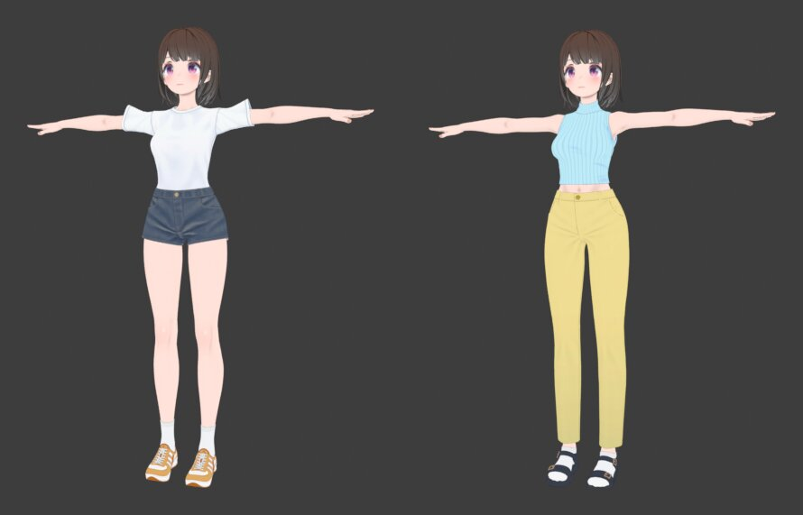

# Outfits

A card's outfits all come into Blender in one import, each in its own collection.

## Changing outfits

Tick Export All Outfits when [exporting](exporting.md#options). In Blender's Outliner each outfit then has a collection (`Outfit 00`, `Outfit 01`, …), and only the first is visible. To change clothes, hide one collection and show another.

Hair and accessories that belong to an outfit change with it.

## Variations

With Export Variations ticked when exporting, the half-off states of the clothes (an unbuttoned shirt, a lifted top) are imported into an `Alts 00`, `Alts 01`… collection beside each outfit's collection, hidden. Show the one you want and hide the piece it replaces.

## Separate all clothing

By default each outfit's clothes are one object. With Separate meshes set to "Separate all clothing" in the [Import Options](importing.md#import-options), each piece of clothing is its own object, named by its material, so a jacket can be hidden or shoes swapped.

## SFW mode

SFW mode (off by default) attempts to cover up some NSFW things: it deletes the NSFW parts of the body mesh and their bones. Turn it on before importing a character you will share or show on screen. With it on, the rig has no controls for the removed parts.

It is an attempt, not a guarantee: check the result before sharing.
