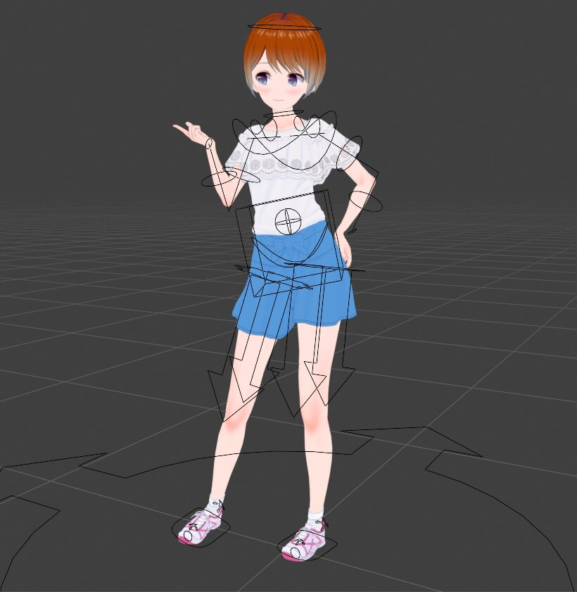
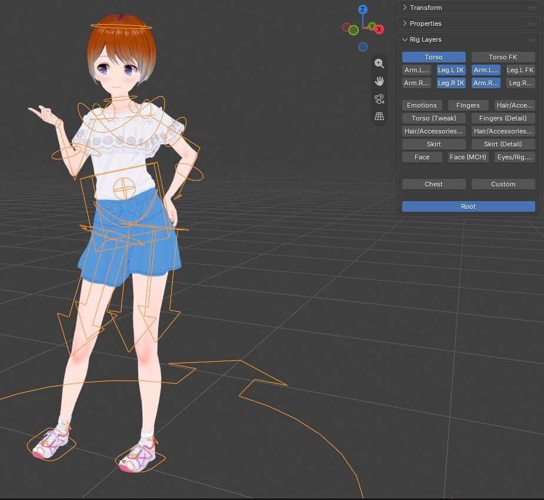
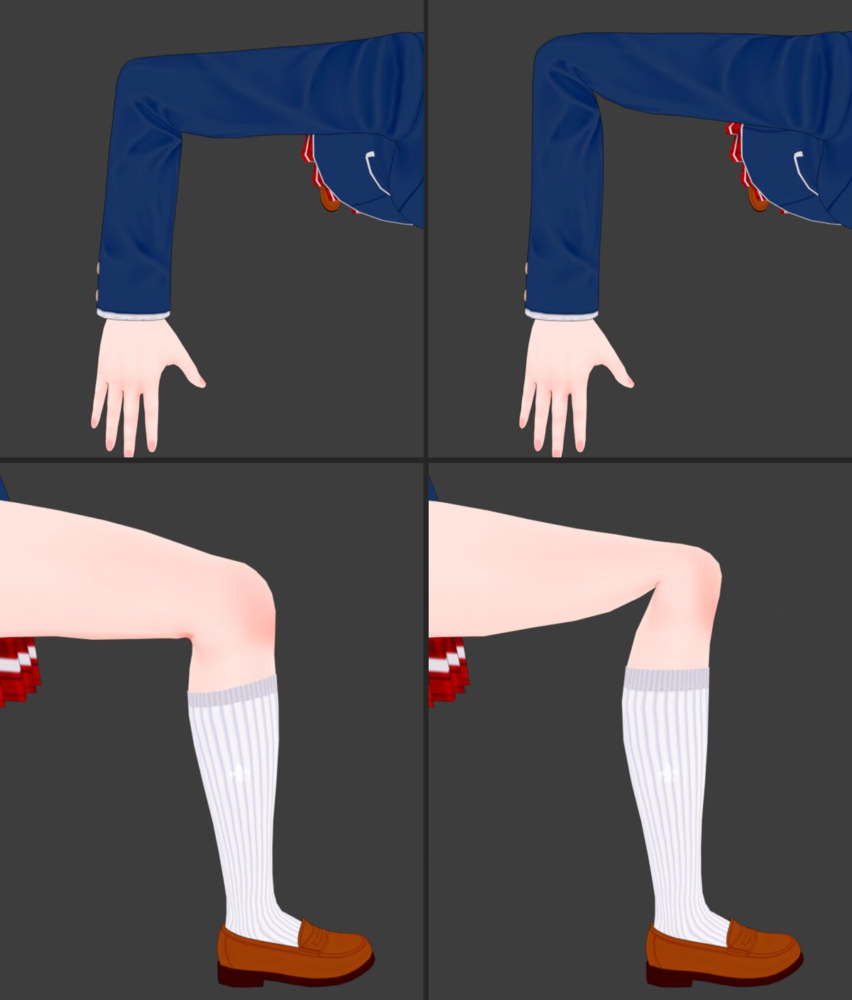

# The rig

With Use Rigify armature on (the default), the character gets a Rigify control rig with IK arms and legs, face controls and the game's own joint corrections.

## Posing

1. Select the rig and enter Pose Mode.
2. Move a hand or foot control; the limb follows.

It is a standard Rigify rig, so Rigify's own panels work: in the sidebar's Item tab, Rig Layers shows and hides groups of controls (fingers, skirt, hair, face and so on), and Rig Main Properties switches a limb between IK and FK.

The controls have readable names (`Left arm`, `Hips`). Hair and accessory bones of each outfit are in their own bone collections, and an empty Custom collection is there for bones you add yourself.

The rig stands the character's lowest point on the floor. IK stretch is off.

## Joint corrections

The game moves small helper bones to keep the elbows, knees, shoulders and hips from collapsing as they bend. KKBP copies the game's own rules for them, so the joints hold their shape as they do in the game's Studio.

The same bent elbow and knee with the joint corrections (left) and with them turned off (right).

Every import has them, with or without Rigify.

## Teeth bones

The Rigify rig has five controls for each row of teeth: the two ends, the two halfway points and the middle. The teeth still follow the mouth as before. The plain armature has none.

## Snap IKs

Snap IKs, in the Tools panel, snaps the rig's IK controls to the current FK pose and switches the limbs to IK. Use it after [importing an animation](animation.md), which arrives as FK, to carry on in IK.

## Without Rigify

With Use Rigify armature off, the character keeps the game's own skeleton as a plain armature. Choose this to send the character to another program with [Export Prep](export-prep.md).

To add the rig to a character imported without it, use Run Hook in the Tools panel and pick Rigify.

## Per game

| | Koikatsu | Koikatsu Sunshine | Summer Vacation Scramble |
|---|---|---|---|
| Rigify rig, joint corrections | Yes | Yes | Yes |

With [SFW mode](outfits.md#sfw-mode) on, the rig has no controls for the parts SFW mode removes.
