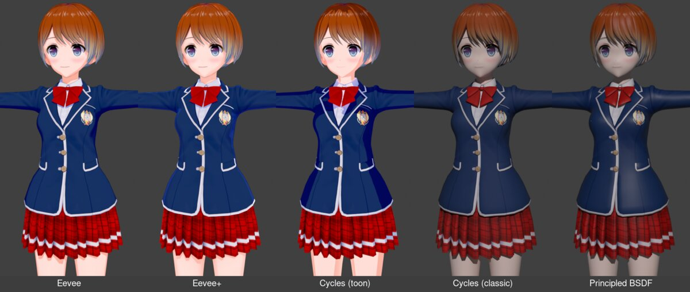
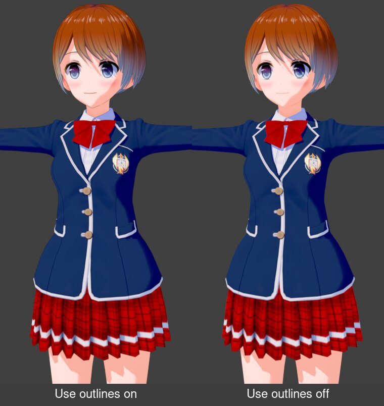

# Shaders and outlines

The Convert shaders option decides how the character's materials are built, and Use outlines adds the game's black outline.

## Choosing a shader

Set Convert shaders in the [Import Options](importing.md#import-options) before importing.

| Shader | Renderer | What you get |
|---|---|---|
| Eevee (default) | Eevee | Toon shading that looks like the game |
| Eevee+ | Eevee | A modified Eevee setup. The eyebrows, eyes, upper eyeline and eye whites are always lit, the face can be shaded by a signed distance field (SDF) texture made for its Game's face, and the face and body normals are reset so no seam shows at the neck |
| Cycles (toon) | Cycles | Toon shaders for Cycles. The eyelines and eyebrows draw without shadows |
| Cycles (classic) | Cycles | The classic Cycles shaders, with the same eyeline and eyebrow handling |
| Principled BSDF | Any | A very simple material: a starting point for your own shading or for other programs |

The shader applies to the body, hair and clothes. The tears and gag eyes keep their own materials.

To change shader after importing, use Run Hook in the Tools panel and pick Convert shaders, or import again.

## Light and dark textures

Each material has a light and a dark version of its texture, baked by the game with its own shader, and the toon shaders blend between the two by the lighting. This is why an imported character matches the game without any setup. To change a colour, see [Edit Material](edit-material.md).

## Outlines

Use outlines (on by default) gives the body, hair and clothes a Solidify modifier and a black outline material for each of their materials. The face's outline is masked so it doesn't draw inside the face.

Outlines are left out for the Cycles and Principled shaders, which draw them badly.

## Per game

| | Koikatsu | Koikatsu Sunshine | Summer Vacation Scramble |
|---|---|---|---|
| Eevee | Yes | Yes | Yes |
| Other shaders | Yes | Yes | Yes, with a warning: the bottom alpha mask is lost |
